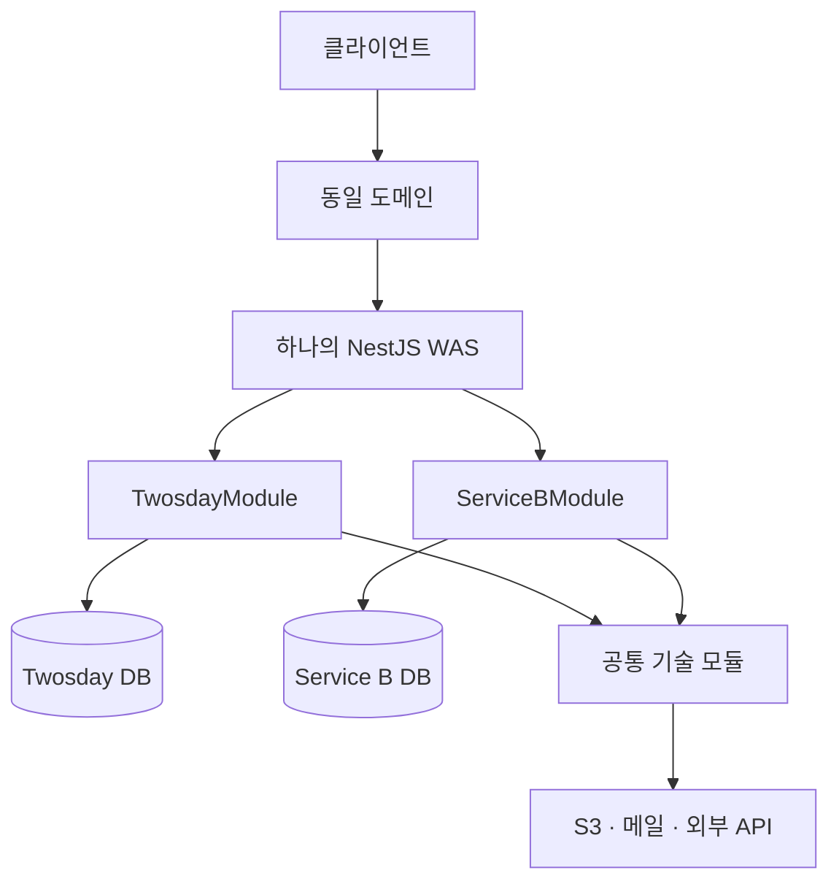

# 단일 WAS 기반 다중 서비스 설계

- 작성일: 2026-10-11
- 상태: 설계 제안 — 애플리케이션 코드 및 DB 변경 전
- 대상: `app/was`의 NestJS 애플리케이션

## 1. 목적과 전제

하나의 WAS에서 여러 서비스를 운영한다. 서비스마다 회원, 인증, 업무 데이터와 DB를 독립적으로 관리하며, 서버 실행 환경과 재사용 가능한 기술 기능을 공유한다.

동일한 도메인으로 들어오는 요청은 API 경로에 따라 해당 서비스가 처리한다. 도메인은 DB 연결 수를 제한하지 않는다.

이 설계에서 말하는 서비스는 Twosday와 같은 독립적인 제품 단위다. NestJS의 `*.service.ts` 클래스와 구분한다.

### 설계 결정

| 항목 | 결정 |
| --- | --- |
| 실행 구조 | 하나의 NestJS 애플리케이션에서 서비스별 모듈 실행 |
| 코드 구조 | 서비스 단위로 업무 기능을 묶는 모듈형 모놀리스 |
| 회원 | 서비스별 회원 테이블과 가입 정책 운영 |
| 인증 | 서비스별 토큰, 인증 설정, 로그인 상태 구분 |
| 데이터 | 서비스별 PostgreSQL 데이터베이스 사용 |
| DB 서버 | 초기에는 하나의 PostgreSQL 인스턴스에 여러 DB를 둘 수 있음 |
| 공통 기능 | 파일 저장, 메일 전송, 로그, 외부 API 클라이언트 등 기술 기능 |
| 배포 | WAS 전체를 함께 배포하고 재시작 |

공통 회원 DB와 통합 로그인은 이 설계의 범위에 포함하지 않는다. 동일한 이메일로 여러 서비스에 가입해도 각각 별개의 회원으로 취급한다.

## 2. 전체 구조



`service-b`는 향후 추가할 독립 서비스의 예시이며 실제 서비스 이름이 아니다. 서비스별 DB는 같은 PostgreSQL 인스턴스에 둘 수 있고, 필요해지면 연결 설정을 변경해 다른 인스턴스로 옮길 수 있다.

DB를 나누어도 WAS의 CPU, 메모리, 이벤트 루프, 배포와 장애 영향은 공유한다. 같은 PostgreSQL 인스턴스의 DB들은 DB 서버 자원도 공유한다. 프로세스와 인프라 수준의 완전한 격리가 필요한 서비스는 추후 별도 실행 단위로 분리한다.

## 3. 디렉터리 구조

```text
app/was/src/
├── main.ts                         # HTTP 서버 시작 및 전역 요청 처리 설정
├── app.module.ts                   # 공통 설정과 서비스 모듈 조립
│
├── config/                         # WAS 공통 설정과 환경변수 검증
│   ├── app.config.ts
│   └── env.validation.ts
│
├── services/
│   ├── twosday/
│   │   ├── twosday.module.ts
│   │   ├── config/                 # Twosday DB·인증·외부 연동 설정
│   │   ├── database/
│   │   │   ├── twosday-database.module.ts
│   │   │   ├── connection.ts       # 연결 이름 및 엔티티 목록
│   │   │   ├── data-source.ts      # 마이그레이션 CLI 진입점
│   │   │   └── migrations/
│   │   ├── auth/
│   │   ├── users/
│   │   ├── media/
│   │   ├── post/
│   │   ├── tag/
│   │   └── reference/
│   │
│   ├── chzzk/                      # 현재 공개된 치지직 API 기능
│   │   ├── chzzk.module.ts
│   │   ├── chzzk.controller.ts
│   │   └── chzzk.service.ts
│   │
│   └── service-b/                  # 신규 서비스 예시
│       ├── service-b.module.ts
│       ├── config/
│       ├── database/
│       │   ├── service-b-database.module.ts
│       │   ├── connection.ts
│       │   ├── data-source.ts
│       │   └── migrations/
│       ├── auth/
│       ├── users/
│       └── ...
│
├── infrastructure/
│   ├── storage/                    # S3 등 실제 파일 저장
│   ├── mail/                       # 메일 전송 클라이언트
│   ├── logging/                    # 로그 및 운영 알림
│   ├── database/                   # 재사용 가능한 연결 옵션 생성 함수
│   └── integrations/               # 공용 외부 API 클라이언트
│       ├── chzzk/
│       └── youtube/
│
└── shared/
    ├── pagination/
    ├── persistence/                # 공통 기본 엔티티 등 기술적 구성 요소
    ├── filters/
    ├── interceptors/
    ├── pipes/
    ├── validators/
    └── utils/
```

위 트리는 책임을 보여주는 목표 구조다. 실제로 필요한 폴더부터 생성한다. DB나 회원 기능이 없는 서비스에 빈 `database`, `auth`, `users` 모듈을 미리 만들지 않는다.

각 기능 폴더는 기존 NestJS 방식으로 구성한다.

```text
services/twosday/users/
├── users.module.ts
├── users.controller.ts
├── users.service.ts
├── users.service.spec.ts
├── dto/
└── entities/
    └── user.entity.ts
```

초기에는 `controller → service → TypeORM repository` 구조를 유지한다. 업무 복잡도가 커질 때 필요한 기능에 한해 유스케이스나 별도 Repository 계층을 도입한다.

## 4. 책임과 의존관계

### 서비스 모듈

각 서비스는 자신의 회원, 인증, 권한, 업무 규칙, 엔티티, DTO, 마이그레이션을 소유한다. 같은 이름의 `users`, `auth` 폴더가 여러 서비스에 있어도 정상적인 구조다.

서비스 내부에서는 다른 기능 모듈이 공개한 provider를 통해 기능을 사용한다. 예를 들어 게시글 기능은 회원 모듈의 조회 기능을 사용하고, 회원 Repository를 직접 가져와 회원 상태를 변경하지 않는다. 서비스 내부 엔티티 간 ORM 관계는 허용한다.

### 공통 기술 모듈

`infrastructure`는 기술적인 입출력을 제공하며, 개별 서비스의 엔티티나 업무 규칙에 의존하지 않는다.

| 공통으로 제공하는 기능 | 각 서비스에 남기는 책임 |
| --- | --- |
| S3 업로드·삭제·서명 URL 생성 | 파일 소유자, 접근 권한, 게시글과의 연결 |
| 이메일 전송 | 가입 정책, 인증 코드 발급·검증, 업무별 메일 템플릿 |
| 외부 API 요청·응답 처리 | 외부 데이터를 활용하는 업무 규칙 |
| 로그·운영 알림 전송 | 업무 이벤트의 의미와 발생 조건 |
| DB 옵션 생성 보조 함수 | 연결 이름, DB 자격 증명, 엔티티 목록 |

서비스별 자격 증명이 다른 외부 연동은 별도 provider token이나 명시적인 설정을 사용한다. 공유 인스턴스의 자격 증명을 요청마다 덮어쓰지 않는다.

`shared`에는 페이지네이션, 예외 처리, 검증 도구처럼 서비스와 무관한 구성 요소를 둔다. 회원 엔티티, 인증 상태, 특정 서비스의 권한 정책은 넣지 않는다.

### 의존관계 규칙

- 서비스는 `infrastructure`와 `shared`를 사용할 수 있다.
- `infrastructure`와 `shared`는 개별 서비스 코드를 import하지 않는다.
- 서비스 A는 서비스 B의 엔티티, Repository, 내부 provider를 직접 사용하지 않는다.
- 서비스 간 연동이 필요해지면 공개된 연동 계약을 별도로 정의한다. 처음부터 내부 HTTP 호출이나 메시지 브로커를 도입할 필요는 없다.
- `AppModule`은 실행에 필요한 모듈을 조립한다. 여러 서비스의 업무 처리를 직접 수행하지 않는다.
- 경로 별칭은 기존 설정에 맞춰 `@/`로 통일한다.

## 5. DB 연결과 마이그레이션

### 연결 구성

서비스마다 이름이 있는 TypeORM 연결을 등록한다. 기본 연결에 의존하지 않고 `forFeature`, `InjectRepository`, `InjectDataSource`에서도 해당 연결 이름을 사용한다.

```typescript
// 개념 예시: 실제 구현 시 해당 파일의 import와 모듈 설정을 추가한다.
export const TWOSDAY_DB = 'twosday';

TypeOrmModule.forFeature([UserModel], TWOSDAY_DB);

// Twosday의 provider 생성자에서 사용
@InjectRepository(UserModel, TWOSDAY_DB)
private readonly usersRepository: Repository<UserModel>;
```

각 서비스의 DB 모듈은 환경설정 주입을 통해 연결을 생성한다. `forRootAsync`를 사용하는 경우 연결 이름은 `useFactory` 내부가 아닌 바깥 옵션에 선언한다.

- 엔티티는 원래 기능 폴더에 둔다. `database/entities`로 모으지 않는다.
- 서비스 DB마다 엔티티 목록을 명시하고 런타임 연결과 CLI DataSource에서 같은 목록을 사용한다.
- 현재의 `/**/*.entity.{js,ts}` 전체 검색을 서비스별 연결마다 복제하지 않는다.
- 서비스별 DB 계정을 사용해 다른 서비스 DB에 대한 권한을 제한한다.
- 각 서비스에 `users`, `posts` 등 같은 테이블 이름이 있어도 DB가 다르면 충돌하지 않는다.
- 서로 다른 DB의 엔티티 간 ORM 관계, 일반 JOIN, 단일 로컬 트랜잭션을 전제로 설계하지 않는다.

하나의 WAS에 여러 DB 연결이 생기므로 연결 풀 크기도 서비스별로 설정한다. 총 연결 수는 WAS 프로세스 수와 각 연결의 풀 크기를 함께 고려한다.

### 환경변수 예시

```dotenv
PORT=8080

TWOSDAY_DB_HOST=localhost
TWOSDAY_DB_PORT=8081
TWOSDAY_DB_DATABASE=twosday
TWOSDAY_DB_USERNAME=twosday_app
TWOSDAY_DB_PASSWORD=<secret>
TWOSDAY_ACCESS_TOKEN_SECRET=<secret>
TWOSDAY_REFRESH_TOKEN_SECRET=<secret>
TWOSDAY_JWT_ISSUER=one-for-all/twosday
TWOSDAY_JWT_AUDIENCE=twosday

SERVICE_B_DB_HOST=localhost
SERVICE_B_DB_PORT=8081
SERVICE_B_DB_DATABASE=service_b
SERVICE_B_DB_USERNAME=service_b_app
SERVICE_B_DB_PASSWORD=<secret>
SERVICE_B_ACCESS_TOKEN_SECRET=<different-secret>
SERVICE_B_REFRESH_TOKEN_SECRET=<different-secret>
SERVICE_B_JWT_ISSUER=one-for-all/service-b
SERVICE_B_JWT_AUDIENCE=service-b
```

위 이름과 값은 목표 구성의 예시다. 실제 비밀값은 저장소에 커밋하지 않고, 필요한 환경변수는 시작 시 검증한다. WAS 공통 설정과 서비스별 설정을 구분해 관리한다.

### 마이그레이션 운영

- 서비스별 `database/migrations`에 변경 이력을 저장한다.
- 서비스별 DataSource를 대상으로 생성·실행 명령을 구분한다.
- CLI와 WAS가 같은 환경과 DB 설정을 사용하게 한다. 현재 `data-source.ts`의 `.env.prod` 고정 로딩은 이관 시 수정한다.
- 런타임과 CLI는 같은 연결 옵션 생성 로직을 사용하되, CLI에서 HTTP 서버를 실행하지 않는다.
- 운영에서는 `synchronize: false`를 유지한다.
- 여러 WAS 프로세스가 시작할 때 동시에 마이그레이션을 실행하지 않도록 별도 배포 단계에서 실행한다.
- 기존 마이그레이션 이력과 적용 상태를 보존한다. 폴더 이동만으로 기존 마이그레이션을 다시 실행하지 않는다.

현재 Docker Compose의 `POSTGRES_DB` 하나만으로 여러 DB가 자동 생성되지는 않는다. 새 서비스 DB와 계정은 별도 프로비저닝 단계에서 생성한다. 기존 데이터 볼륨에는 최초 초기화 스크립트가 다시 실행되지 않으므로, 기존 볼륨을 삭제하는 방식으로 이관하지 않는다.

## 6. 인증과 API 경계

### API 경로

| 서비스 | API 예시 |
| --- | --- |
| Twosday | `/api/twosday/auth`, `/api/twosday/users`, `/api/twosday/posts` |
| Service B | `/api/service-b/auth`, `/api/service-b/users` |
| Chzzk | `/api/chzzk/lives` |

서비스 접두사는 한 곳에서 일관되게 구성한다. 기존 컨트롤러 경로를 이관할 때 전역 `/api` 접두사와 중복되지 않게 한다. 기존 URL이 달라지는 경우 프런트엔드와 OAuth 콜백 설정도 함께 이관한다.

### 서비스별 인증

- 회원 ID는 해당 서비스 안에서만 의미를 가진다. 서비스가 다르면 같은 숫자의 ID가 있어도 별개의 회원이다.
- 토큰은 서비스별 서명 키, `issuer`, `audience`를 사용하고 발급과 검증 양쪽에 적용한다.
- 액세스 토큰과 리프레시 토큰은 용도도 구분해 검증한다.
- 각 서비스의 인증 guard는 해당 서비스의 토큰만 받아들인다. 공통 전역 guard가 모든 서비스를 같은 정책으로 인증하지 않도록 한다.
- 동일 프로세스에서 Passport 전략 이름이 충돌하지 않도록 `twosday-google`, `service-b-google`처럼 이름을 구분한다. 사용하는 전략과 guard의 이름을 함께 맞춘다.
- OAuth 콜백 경로, 가입 정책, 계정 상태, 서비스 권한은 각 서비스가 관리한다.

### 쿠키

현재 공통 `refresh_token` 쿠키와 `/` 경로는 여러 서비스에서 충돌할 수 있으므로 서비스별로 나눈다.

| 서비스 | 쿠키 이름 예시 | Path 예시 |
| --- | --- | --- |
| Twosday | `twosday_refresh_token` | `/api/twosday/auth` |
| Service B | `service_b_refresh_token` | `/api/service-b/auth` |

쿠키 Path는 실제 갱신·로그아웃 요청 경로를 포함하도록 정한다. 쿠키 삭제 시에도 발급할 때의 Path와 Domain을 사용한다. Domain은 서브도메인 공유가 필요한 경우에만 설정하고, `HttpOnly`, 운영 HTTPS의 `Secure`, 로그인 흐름에 맞는 `SameSite`를 적용한다.

쿠키 Path는 브라우저의 전송 범위를 조절하는 설정이다. 같은 출처의 서비스 사이에 강한 보안 격리를 제공하지 않는다. 프런트엔드 저장소와 실행 코드까지 서로 신뢰할 수 없는 서비스라면 별도 출처 구성을 검토해야 한다.

## 7. 기존 코드 이관 계획

현재 `AppModule`에는 단일 DB 연결이 등록되어 있고, `auth`, `user`, `image`가 최상위 모듈로 존재한다. 회원·이미지 엔티티는 Twosday 게시글 엔티티와 직접 연결되어 있다.

이 관계를 근거로 기존 회원·인증·이미지를 Twosday 소유로 이관하는 것을 기본안으로 한다. 실제 사용처를 확인해 다른 서비스의 데이터가 섞여 있으면 먼저 소유권을 구분한다.

| 현재 위치 | 목표 위치 또는 처리 |
| --- | --- |
| `src/twosday/*` | `src/services/twosday/*` |
| `src/auth/*` | `src/services/twosday/auth/*` |
| `src/user/*` | `src/services/twosday/users/*` |
| `src/image/*` | 업무 기능은 `services/twosday/media`, 기술적 파일 저장은 `infrastructure/storage` |
| `src/aws/*` | 사용 기능에 맞춰 `infrastructure/storage` 등으로 분리 |
| `src/mail/*` | 전송 기능은 `infrastructure/mail`, 업무 템플릿과 인증 로직은 해당 서비스 |
| `src/log/*` | `src/infrastructure/logging/*` |
| `src/common/common.service.ts` | 역할에 맞춰 `shared/pagination`의 `PaginationService`로 정리 |
| `src/common/entity/base.entity.ts` | `src/shared/persistence/base.entity.ts` |
| `src/common/*`의 나머지 코드 | 사용처와 책임에 따라 서비스 내부 또는 `shared`로 이동 |
| `src/chzzk/*` | API 기능은 `services/chzzk`, 재사용할 외부 요청 기능은 `infrastructure/integrations/chzzk` |
| 루트 필터·인터셉터 | 서비스와 무관한 처리만 `shared`로 이동 |
| `app/was/data-source.ts` 및 기존 마이그레이션 | Twosday DB 구성으로 이관하고 CLI 스크립트 갱신 |

Twosday 회원·게시글·이미지는 같은 서비스와 DB에 속하므로 기존 ORM 관계를 유지할 수 있다. 다른 서비스가 공통 회원을 사용하도록 관계를 바꾸지 않는다.

### 적용 순서

1. 기존 데이터 소유권, API 호출처, 인증 설정, 마이그레이션 적용 상태를 확인한다.
2. 서비스 폴더로 코드를 이동하고 import를 수정한다. 이 단계에서는 기존 API와 DB 동작을 유지한다.
3. 파일 저장·메일 전송 등 공통 기술 기능과 서비스 업무 기능을 분리한다.
4. 기존 DB를 Twosday의 이름 있는 연결로 등록하고 Repository 주입 및 CLI 구성을 수정한다. 물리적인 DB 이름 변경이나 데이터 이동은 필수가 아니다.
5. 인증 키·전략·쿠키·API 경로를 서비스별 구성으로 이관한다. 변경으로 기존 로그인이 무효화되면 재로그인 정책을 프런트엔드와 함께 적용한다.
6. 신규 서비스에 독립된 DB·계정·회원·인증 모듈을 추가한다.
7. 서비스 간 데이터 및 인증 격리를 검증한 뒤 배포한다.

폴더 이동, 인증 변경, 물리적인 데이터 이동은 검증 가능한 단계로 나누어 적용한다.

## 8. 신규 서비스 추가 기준

새 서비스를 추가할 때는 다음 작업을 수행한다.

1. `services/<service-name>`에 루트 모듈과 필요한 기능을 만든다.
2. 서비스의 API 접두사를 정하고 기존 경로와 충돌하지 않는지 확인한다.
3. 데이터 저장이 필요하면 DB·계정을 생성하고 이름 있는 연결과 마이그레이션 명령을 등록한다.
4. 회원 기능이 필요하면 자체 회원·인증 모듈을 추가한다. 다른 서비스의 회원 엔티티를 가져오지 않는다.
5. 환경변수, 인증 키, 쿠키 이름, Passport 전략 이름, OAuth 콜백을 구분한다.
6. 파일 저장 시 서비스별 키 접두사를 사용하고, 소유권과 접근 권한은 서비스 DB에서 관리한다.
7. `AppModule`에 서비스 모듈을 등록하고 API 문서·로그에서 서비스를 식별할 수 있게 한다.

## 9. 검증 기준과 운영 제약

구현 완료 여부는 다음 동작으로 확인한다.

- 기존 Twosday 회원·게시글·이미지 기능이 유지된다.
- 같은 이메일로 서비스 A와 B에 각각 가입할 수 있으며, 한쪽의 탈퇴·비밀번호 변경이 다른 쪽에 영향을 주지 않는다.
- A의 액세스·리프레시 토큰을 B에 전달하면 인증이 거부된다.
- A의 로그인·로그아웃이 B의 쿠키를 덮어쓰거나 삭제하지 않는다.
- 각 Repository가 해당 서비스 DB만 사용하며, 다른 DB의 엔티티가 연결에 등록되지 않는다.
- A의 마이그레이션 실행이 B의 DB와 마이그레이션 이력을 변경하지 않는다.
- 업로드 파일은 서비스 및 소유자 권한 검사를 통과한 경우에만 접근·변경할 수 있다.
- 공통 기술 코드가 개별 서비스의 엔티티나 업무 provider를 import하지 않는다.
- WAS 빌드와 변경에 관련된 단위·통합 테스트가 통과한다.

일반적인 NestJS TypeORM 초기화에서는 등록된 DB 중 하나에 연결하지 못하면 WAS 전체 시작이 실패할 수 있다. 초기 설계에서는 등록된 DB를 필수 의존성으로 취급한다. 서비스별 독립 가용성이 필요해지면 별도 초기화·장애 처리 설계를 추가하거나 WAS를 분리한다.

서비스별 DB 분리는 코드와 데이터 소유권의 경계다. 독립 배포나 장애 격리는 별도의 실행 구조 변경이 필요하다.

## 10. 참고 문서

- [NestJS Modules](https://docs.nestjs.com/modules): 기능별 모듈 구성과 공개 provider 경계
- [NestJS Database](https://docs.nestjs.com/techniques/database): 여러 DB 연결과 이름 있는 Repository 주입
- [TypeORM Multiple Data Sources](https://typeorm.io/docs/data-source/multiple-data-sources/): 여러 DataSource 구성
